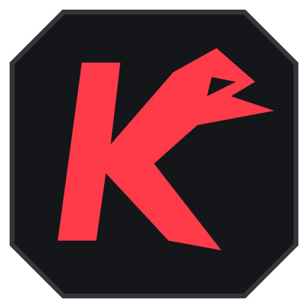

<p></p>

# Karasu Helper 1.2.4

Auto accept, veto priorities, FACEIT ranks and a colour-matched loadout builder for Karasu. Unofficial community extension by **totalnabaklaszka**.

**[Download Karasu Helper 1.2.4](downloads/karasu-helper-1.2.4.zip?raw=true)** · [Buy me a coffee on Ko-fi](https://ko-fi.com/totalnabaklaszka) · [Privacy](PRIVACY.md)

## Microsoft Edge Add-ons preparation

The [Edge submission kit](store/edge/README.md) contains the store description, permission explanations, reviewer notes and logo. Download the [complete submission kit](downloads/karasu-helper-edge-submission-1.2.4.zip?raw=true) to prepare a Partner Center draft. Upload the **inner extension ZIP** as the package, and upload artwork separately.

This is preparation for a store submission. Karasu Helper has not been submitted to or approved by Microsoft, and there is no Edge store installation link yet. Manual installation below remains available.

Version 1.2.4 shortens the manifest description to the Chromium limit, adds the project homepage and supplies Edge store materials. Match and skin behavior is unchanged.

## Support

Karasu Helper is free. If it saves you time, you can [buy me a coffee on Ko-fi](https://ko-fi.com/totalnabaklaszka). Tips are optional and do not unlock or restrict any features. Thank you for supporting the project.

## Install

1. Download the extension ZIP using the link above and extract it to a permanent folder.
2. Open `chrome://extensions`, `edge://extensions` or `brave://extensions`.
3. Enable **Developer mode** and click **Load unpacked**.
4. Select the extracted folder containing `manifest.json`, then refresh Karasu.

The ZIP in `downloads/` is the ready-to-install extension. The repository contains the complete source as well. No developer registration fee is needed for this manual installation.

Version 1.2.2 renames the extension to **Karasu Helper**. Existing settings are preserved when the same installed folder is reloaded.

Version 1.2.1 removes the background-assist hint from Queue and removes the My inventory browsing tab. Background automation and full-catalog crafting remain available.

## New in 1.2.0

- **Loadout Studio:** colour presets, minimum market value in USD, minimum rarity, favorites and value sorting.
- **Build a set:** randomise a loadout, lock good slots, reroll individual slots or all unlocked slots, then save up to 12 named sets.
- **Craft & equip loadout:** submit a preview sequentially, use one crafted instance for an identical CT/T skin, and stop after the current skin when requested. Failures stop the batch.
- **Selection dock:** the selected skin and CT / T / Both actions stay outside the scrolling list. No scrolling back to the top to equip a result.
- **Background assist:** server-rendered page changes wake the adapter, and short countdown deadlines are also scheduled in the extension worker. Enabled automation protects the Queue/match tab from automatic memory discard.
- **New raven/K identity:** angular red mark, antialiased toolbar icons and a wider 420px popup. Use the expand button for the full Settings page.

Studio features are unlocked in this preview release. No subscription, payment screen or license server is included.

A minimal English extension for Brave, Chrome and Edge. Light and dark themes use neutral backgrounds, compact controls, Space Grotesk typography and a red accent. Settings live in the extension popup. No toolbar, floating button or drawer is injected into Karasu.

The sun and moon buttons in the header switch between **Light mode** and **Dark mode**. The choice is saved on the device and shared by the popup and Settings page. Appearance preferences are stored separately from match settings, so changing the theme does not change automation or restart a countdown. Routine waiting text is hidden; action confirmations and errors still appear. The footer reads **made by : totalnabaklaszka**.

Space Grotesk is bundled locally, including its SIL Open Font License in `extension/fonts/OFL.txt`. Opening the panel does not request a web font. Font source: [Google Fonts](https://github.com/google/fonts/tree/main/ofl/spacegrotesk).

## Update an existing installation

1. Keep using the same `extension` folder that you originally loaded.
2. Open `brave://extensions`, `chrome://extensions` or `edge://extensions`.
3. Click **Reload** on Karasu Helper.
4. Refresh your open Karasu tabs. This removes the old page toolbar and floating button.
5. Click the extension icon to open **Queue**, **Maps**, **Servers** or **Skins**.

Saved toggles, delays and supported ban priorities are preserved. Vertigo and unsupported server entries are removed from old preferences. Session status and activity text are reset on update.

If a new popup is opened while an older installed manifest or service worker is still running, it asks you to reload the extension before making skin requests. Reloading the website alone does not update the extension worker. Panel messaging accepts browser-provided extension ID/origin metadata even when the optional sender URL is absent; website content scripts cannot use the privileged skin relay.

For a new installation, enable Developer mode, choose **Load unpacked** and select the folder containing `manifest.json`. The release ZIP contains only extension files. Unzip it into a permanent folder before loading it.

## Queue and bans

- **Queue:** auto accept and a 1–10 second delay (default: 3 seconds).
- **Maps:** seven maps — Mirage, Nuke, Dust2, Ancient, Inferno, Cache and Anubis. Vertigo is excluded from both saved priorities and automatic candidates.
- **Servers:** Madrid, Düsseldorf, Istanbul, Prague and Stockholm. Karasu internally calls Madrid `barcelona`; the adapter preserves that mapping.
- Use **+**, **↑**, **↓** and **×** to edit priorities. Ban first to last, then continue in the fixed catalog order. Unrecognised live options follow alphabetically, except Vertigo.
- Map and server bans have independent switches and a shared 1–10 second delay (default: 2 seconds).
- **Disable all** switches off all three automatic match features and Auto-copy connect. FACEIT display preferences are kept.

You join the queue yourself. The extension checks the current confirmation, captain permissions, turn, available options and deadlines immediately before submitting through Karasu's existing actions. It preserves manual selections and does not ban the last remaining option. Map picks and side choices remain manual.

Multiple tabs coordinate claims through the service worker. Claims survive worker suspension. A submitted match action is not retried without server evidence. Keep Karasu and the browser open; frozen tabs, sleep and network loss can prevent timely actions.

Alt+Tab and playing a deathmatch do not need the popup to stay open. A MutationObserver watches Karasu's rendered app for changes, so detection does not rely only on a hidden page's polling timer. A bounded worker wakeup (at most 10 seconds) handles an active accept/ban countdown, then releases its timer. The adapter rechecks permissions, deadlines and manual selections before submitting. There is no perpetual background keepalive, simulated input, game control or automatic game launch. Memory protection restores the previous auto-discard setting when automation is switched off or the page unloads. This improves background operation; a suspended/frozen tab, closed browser, disconnected site or sleeping computer can still prevent it.

## Auto-copy connect

Enable **Queue → Auto-copy connect** to copy `connect IP:port` when your match server is ready. This setting defaults to off and is separate from acceptance and ban settings. A different server address for the same match is copied again; unchanged addresses are deduplicated across tabs and service-worker restarts in the current browser session.

Only your participating match, an available server, and a waiting-for-server or live match state qualify. The adapter reads Karasu's existing `connection_string`, `is_in_lineup`, `is_match_server_available` and status fields. Before writing, the worker verifies the current connection again in the originating match tab. Only a single validated IPv4 address and port are copied; extra commands, newlines and out-of-range addresses/ports are rejected. No game is opened or controlled.

The extension requests **clipboardWrite** and **offscreen** permissions for the bundled clipboard helper. It writes the connect command without reading the previous clipboard contents. It does not open a visible tab or window. Successful writes appear in Recent activity; failures are reported without claiming success. An interrupted submission is not automatically repeated for the same address. The implementation follows [Chrome's offscreen API guidance](https://developer.chrome.com/docs/extensions/reference/api/offscreen) and [official clipboard example](https://github.com/GoogleChrome/chrome-extensions-samples/tree/main/functional-samples/cookbook.offscreen-clipboard-write).

## FACEIT ranks

**Queue → FACEIT ranks** shows a small orange FACEIT marker, level and ELO immediately beside each player's Karasu ELO in the match overview scoreboard. It is enabled by default. The display preference is saved separately from match automation, so switching it does not restart a countdown or change ban priorities.

**Queue → Rank style** offers three saved display presets: **Badge** (default, a dark circular level icon with a colored progress arc), **Label** (`LVL 8` with ELO) and **Minimal** (`8 · 1664 ELO`, no badge border). Badge colors run from gray through green, yellow and orange to red for level 10. Numbers use aligned tabular digits and a small ELO caption; on narrow screens the caption is hidden to keep rows compact. The choice updates open match pages and other settings panels automatically.

The badge reads FACEIT fields already supplied in Karasu's `LineupOverviewRow` player props, matched by Steam ID. Current `faceit_elo` / `faceit_skill_level` fields take precedence; if only `faceit_rank_history` is available, the tooltip labels it **At match start**. Missing data shows a dash. The tooltip identifies the source as Karasu; the badge does not claim to be a direct, real-time FACEIT synchronization. A valid FACEIT profile link opens when the user clicks the badge.

There are no additional API requests, API keys or profile synchronization mutations. Existing native FACEIT badges on imported matches are left alone. Updates follow Karasu's reactive player data and row sorting; badges are removed when disabled or when leaving the match page. The extension adds only these compact badges to the page, with no toolbar or floating controls.

The implementation follows public Karasu source inspected on 28 October 2026:

- `https://karasu.live/_nuxt/B57rA7Bs.js` (`LineupOverviewRow`, ELO cells)
- `https://karasu.live/_nuxt/BAOotGbB.js` (match player fields and FACEIT rank history)
- `https://karasu.live/_nuxt/DeLOVTBz.js` (`PlayerElo`, native FACEIT rank display)

## Skins

Open a Karasu tab, then open **Skins** in the extension. **Catalog** includes skins you do not own. Public catalog browsing does not require private inventory reads. Sign in to craft/equip a catalog skin.

- Choose a **Team filter** and a weapon. The default is all weapons and both teams. A single-skin preview has three explicit buttons: **Craft for T**, **Craft for CT** and **Craft for Both**. Incompatible teams are disabled. Both equips only compatible teams: an AK-47 is equipped for T, while a compatible shared skin uses one crafted instance for CT and T.
- Search by finish name or colour, for example `red AK`, `Cyrex` or `blue`. Colour chips use approximate finish-name tags; they do not use the rarity colour or image analysis. Untagged finishes still appear in ordinary name searches.
- Doppler names include the catalog variant: **Phase 1–4**, **Ruby**, **Sapphire**, **Black Pearl**, or **Emerald** for Gamma Doppler. This label appears in catalog results, owned inventory previews and random loadouts. Search accepts both `Phase 1` and `P1`. Karasu's `altName` is authoritative; known material/image filenames provide a fallback when older inventory records omit it. No variant is inferred from image colors.
- **Catalog:** browse the full catalog across all weapons, or narrow it to one weapon. Selecting a result opens a **Craft & equip** preview in the panel. Choose a team button to create and equip that skin directly; no new tab opens.
- **Random weapon:** preview a catalog skin matching the team, weapon, colour and search filters, then choose **Craft for T / CT / Both**.
- **Random loadout:** generate compatible catalog choices for the selected team(s), current weapon roster, knife and gloves. Click **Equip** next to an individual skin to craft and equip that row; generating the preview performs no writes. If the signed-in loadout cannot be read, use the default CT/T weapon roster and label this in the preview. This uses the colour/value/rarity filters and ignores the single-weapon and text filters; slots without a match are skipped.

The user-confirmed plugin address is `https://karasu.live/apps/inventory`; the main Skins shortcut is always available. Catalog previews never send an equip or craft request. The catalog is fetched with at most four requests in parallel, cached per weapon in the tab and deduplicated by catalog ID.

**Craft & equip** uses catalog defaults: minimum supported wear, default pattern, StatTrak off, no name tag, stickers, patches or charm. The adapter reads the current inventory and active preset, checks the skin's server-provided catalog metadata and weapon compatibility, crafts one instance, verifies it exists, equips it, then reads back the loadout. It does not accept custom craft payloads from the panel. Duplicate operation IDs cannot submit twice. Interrupted or partially confirmed operations are not automatically repeated; the panel asks the user to check their inventory on Karasu. A skin that was created before an equip failure remains there.

After applying, refresh the Karasu Skins page if its own preview is stale. These actions affect Karasu's cosmetic inventory/loadout. The extension does not delete items, purchase anything, or perform Steam trades.

## Loadout Studio

Open **Skins → Loadout filters**. Pick a colour, minimum value, minimum rarity and CT / T / Both. Redline, Ice, Toxic and Clean are quick colour shortcuts. **Skip default skins** is enabled by default. Filters affect the catalog, Random weapon and Random loadout. If no candidate matches a loadout slot, that slot remains unchanged; the extension does not silently lower the value or change colour.

Star a catalog item to save a favorite; the star beside the source tabs filters to favorites. **Value ↑ / ↓** sorts priced results, keeping unknown prices at the end. These settings are saved independently from match automation.

**Random loadout** opens a docked preview. Use the circle next to a slot to lock it, the arrow to reroll just that slot, or **Reroll unlocked** for the rest. Give the set a name and click **Save**. Up to 12 sets are stored on this device. Reusing a name updates that set. Loading a saved set only previews it and revalidates catalog IDs, slot compatibility and team restrictions against the current roster. Missing or incompatible slots are skipped.

Click **Equip** per row or **Craft & equip loadout** for the remaining rows. An identical catalog skin selected for CT and T is crafted once and equipped on both sides. The batch runs sequentially, stops on a failure, and reports partial progress. **Stop after this skin** finishes the in-flight request and submits nothing else. An uncertain result blocks further batch submission in that preview and asks you to check inventory. For longer batches, keep the full Settings page open using the expand button; closing the popup can interrupt its batch controller.

### Indicative market values

Values are **the lowest available normal Skinport listing in USD across wear conditions**, grouped by finish and exact Doppler phase/gem variant. StatTrak and Souvenir listings are excluded. The filter uses this indicative floor to avoid cheap finishes; it is not a charge or a valuation of a Karasu item. **Karasu crafting remains free.** Unknown or out-of-stock finishes have no value and are excluded when the minimum is above zero. Rarity is a separate filter and is never treated as a price.

A compact dated snapshot ships with the extension and works without a price-provider permission or external request. A newer saved snapshot takes precedence over an older bundled one, and extension updates can supply a newer bundle. **Update prices** requests optional access only to `https://api.skinport.com/*`, then performs a public read without cookies, account identifiers or API keys. There is a five-minute update cooldown; provider failures preserve the previous snapshot. [Skinport's public Items API](https://docs.skinport.com/items) documents the source, five-minute cache and eight-request-per-five-minute limit. There are no affiliate links or automatic price polling.

Studio preferences, favorites, named sets and cached prices are stored locally. They contain catalog selections rather than Steam credentials or browser history. See [PRIVACY.md](PRIVACY.md).

## Validation and integration boundaries

The match adapter is based on Karasu's public Nuxt components. The Skins API is based on the public app and API catalog inspected on 28 October 2026:

- `https://inventory.karasu.live/assets/App-C0gVngjU.js`
- `https://inventory.karasu.live/assets/compositeStore-DwJVK8t7.js`
- `https://inventory.karasu.live/api/catalog`
- `https://inventory.karasu.live/api/catalog/skins?slot=ak47`
- `https://inventory.karasu.live/api/catalog/items?ids=221`

Inventory/loadout reads and writes use the same API routes and session-based credentials as Karasu's app. The public catalog response confirms CORS for `https://karasu.live` with credentials. The Skins adapter writes only to `POST /api/inventory/craft` and `POST /api/loadout`, after an explicit user click. API requests are fixed to `https://inventory.karasu.live/api`; this adds no browser permissions. Cosmetic requests have their own queue and cannot block match claims.

Tests run entirely in memory with mocked network calls, component trees, extension messaging and storage. They cover countdowns, manual overrides, multi-tab coordination, priority migration, skin search, compatible loadout planning, preview/apply behaviour, stale states, partial failures and server confirmation. No browser automation, logged-in session changes or live-match tests were performed. Karasu can change its internals or API, so real account execution still needs manual verification after loading the update.

The Studio tests additionally cover a ready dialog after six simulated minutes without page interval polling, worker countdown wakeups, memory setting restoration, price matching by Doppler variant, optional permission denial, unknown prices, locked slots, saved-set previews, CT/T grouping and stopping an in-flight craft batch.

## Development

```text
npm ci
npm test
npm run check
npm run build
npm run source
```

`npm run icons` regenerates the SVG/PNG raven mark. `npm run prices` refreshes the bundled public price snapshot; it is an explicit maintenance command and is not run automatically by builds or tests.

`scripts/icons.cjs` regenerates the bundled icons. `scripts/package.ps1` packages only `extension/` into `release/karasu-helper.zip`.

`npm run source` creates a separate source archive using an explicit folder/file allowlist. Publication details and the prepared English release notes are in [PUBLISHING.md](PUBLISHING.md). No build command publishes anything to GitHub or a browser store.
